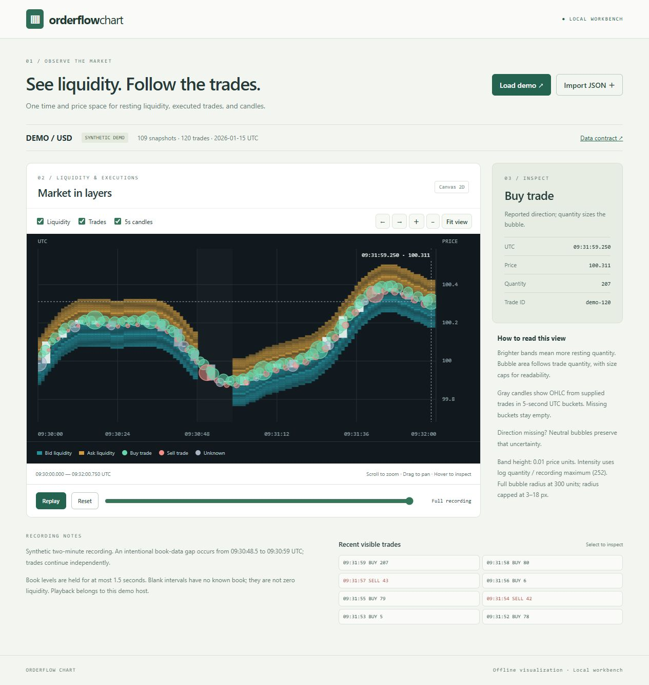

# Orderflow Chart

A Canvas 2D library and local workbench for viewing liquidity, trade bubbles and
trade-derived candles in the same time/price space. Use it to inspect how quoted
depth changes around trades, explore a recorded interval, or embed these views
in your own research interface.



*The bundled synthetic recording; no external market dataset is included.*

## Run

Requires Node 22 or later. There are no runtime packages to install and no build
pipeline:

```sh
git clone https://github.com/Deamenophobia/orderflow-chart.git
cd orderflow-chart
npm run dev
```

Open <http://127.0.0.1:8790>. The initial two-minute demo is synthetic, including
an intentional book-data gap. Import accepts chart JSON or an exported Book
Replay report. Files remain in the browser; the demo makes no external requests.

The workbench supports layer visibility, time zoom/pan, fit view, crosshair and
event inspection, keyboard navigation, and host-controlled playback. The recent
trade list provides a keyboard-accessible route to inspecting bubbles. The canvas
also accepts Left/Right to pan, +/- to zoom and Home to fit the recording.

## Bring recorded trades

The companion [Book Replay](https://github.com/Deamenophobia/book-replay) CLI
converts existing SQLite trade tables into this chart's input format:

```sh
book-replay import-trades-sqlite history.db --table hist-trades --condition-id YOUR_ID --side DOWN --books recording.db --output chart.json
```

Import `chart.json` using the workbench's **Import JSON** control. Omit `--books`
for a trade-only view, or select `--table ticks` for the supported live recorder
format. The importer preserves known BUY/SELL direction, marks missing direction
as unknown, applies the source's explicit timestamp/price-basis rules, and omits
wallet fields. See its [recorded-trade contract](https://github.com/Deamenophobia/book-replay/blob/main/docs/recorded-trades.md)
before using a different collector format.

[examples/recorded-trades.json](examples/recorded-trades.json) is a small synthetic
file produced by that CLI. It contains one book snapshot and four historical
trades, including two at the same timestamp and one with unknown direction.

## Embed

```js
import { OrderflowChart, fromReplayReport } from './src/chart.js';

const chart = new OrderflowChart(canvas, {
  priceStep: 0.01, // Explicit band height in the instrument's native price units.
  holdMs: 1500,   // Maximum time to display a snapshot before marking a gap.
  candleMs: 5000, // UTC buckets derived only from supplied trades.
  onInspect: detail => showDetails(detail),
});
chart.setData(chartDataset);
chart.setCursor(1768479001000); // Host owns playback; null shows the full recording.
chart.setLayers({ candles: false });
chart.fit();
// For an existing Book Replay export:
chart.setData(fromReplayReport(replayReport));
// On teardown:
chart.destroy();
```

Give the canvas a CSS width and height. `setData` validates before replacing the
current recording. `getViewport`, `zoom`, `pan` and `inspectTrade` are also
available. This library does not collect data, reconstruct incremental books,
place orders or own a playback clock.

## Semantics

- Cyan/amber bands represent bid/ask snapshot quantity. Intensity is logarithmic
  against a fixed maximum across the loaded recording.
- Green/red bubbles represent explicitly supplied buy/sell trade direction.
  Unknown direction stays neutral and has a short horizontal mark. Bubble area
  follows quantity between radius limits of 3 and 18 CSS pixels.
- Gray candles show OHLC from supplied trades in UTC buckets, including a partial
  candle at the replay cursor. Empty buckets are omitted. These are display
  aggregates, not independently sourced venue candles.
- Snapshots are held until the next snapshot or `holdMs`, whichever comes first.
  A gap means unknown book state, not zero liquidity. Equal-time snapshots use
  the final arrival for that time. The replay cursor is time-based, not a source
  sequence cursor.
- Decimal text is retained for inspection; pixel positions and candle values use
  approximate JavaScript numbers. This is not a financial calculation engine.
- The full recording sets axis bounds and size/color references; the cursor hides
  future marks and excludes future trades from candles. It is an inspection UI,
  not a look-ahead-free strategy simulator.

See [the input contract](docs/input-format.md) for the data interface. A Book
Replay report supplies complete book frames but no trade records: importing one
leaves bubbles and candles empty. Raw Book Replay input events must first be
replayed by its Rust core.

## Scope and reuse

The Canvas setup, scaling and line-drawing helpers are adapted from existing
owner-provided frontend code. The layered renderer and small standalone host are
new implementation based on the recovered chart requirements and collector
semantics. This is not presented as the exact recovered deployed chart revision.
Private source mapping is maintained separately; see [NOTICE](NOTICE) for the
public attribution statement. The project is an experimental offline tool.
Book Replay integration currently uses file import; its browser playback controls
are not connected directly to this workbench.

## Checks

```sh
npm test
npm run check
```

Focused checks cover snapshot gaps/ties, partial candles without future trades,
unknown direction, decimal input and Book Replay report mapping. Browser checks
exercise actual rendering and interaction. Defaults limit input to 5,000 book
snapshots, 20,000 trades and 200,000 levels; browser file import is capped at 8 MiB.
Large recordings need profiling before changing renderers or adding aggregation.

GitHub CI runs the same existing checks. See [verification](docs/verification.md)
for the browser checks performed and their limits.

## License

[MIT](LICENSE), copyright 2026 Deamenophobia. The repository is distributed as
source; no npm package is published. The package's `private` flag prevents
accidental npm publication and does not affect the GitHub repository's visibility.
